<h1 align="center">Campus Augustusplatz</h1>

<p align="center">
  <b>3D-Druckmodelle der Universität Leipzig</b><br>
  Neues Augusteum · Paulinum · Hörsaalgebäude und mehr – erzeugt aus OpenStreetMap-Daten
</p>

<!-- AUTO:hero -->
<p align="center">
  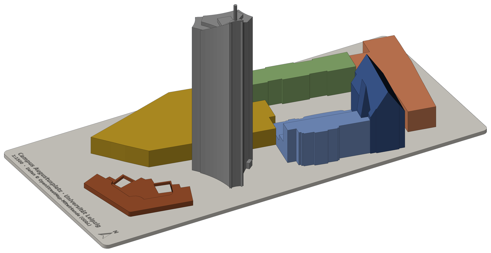
</p>
<!-- /AUTO:hero -->

<p align="center">
  <b>7 Gebäude</b> &nbsp;·&nbsp; <b>2 Maßstäbe</b> &nbsp;·&nbsp; STL &amp; 3MF &nbsp;·&nbsp; ohne Stützen druckbar
</p>

Jedes Gebäude lässt sich einzeln drucken. Zusätzlich gibt es ein Komplettmodell
und eine Grundplatte mit Aussparungen, in die man die einzeln gedruckten Gebäude
einsetzen kann.

## Der Campus in zwei Detailstufen

Dasselbe Modell in zwei Größen – hier im gleichen Bildmaßstab, damit der
Unterschied sichtbar bleibt. Die Farben entsprechen den getrennten Objekten der
3MF-Datei, die sich im Slicer einzeln umfärben oder weglassen lassen.

<!-- AUTO:campus -->
<table>
<tr><th align="center"><b>1:1500</b><br><sub>kompakt</sub></th><th align="center"><b>1:1000</b><br><sub>groß, mehr Detail</sub></th></tr>
<tr><td align="center" valign="bottom">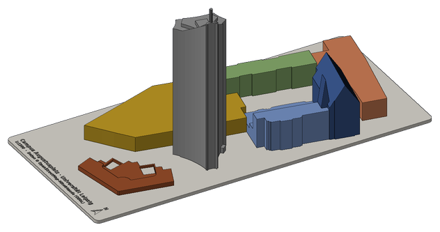</td><td align="center" valign="bottom">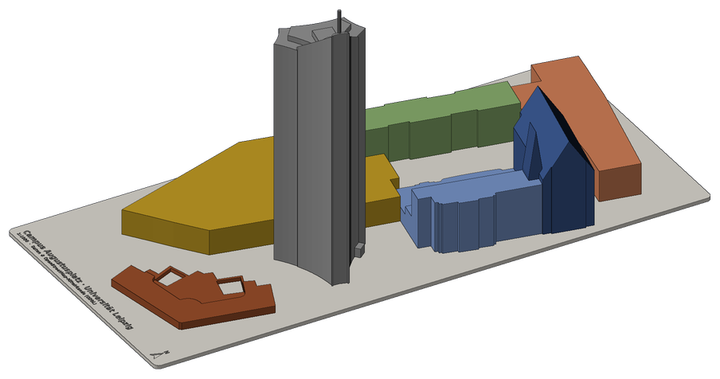</td></tr>
<tr><td align="center"><sub>100 × 215 × 105 mm<br>passt auf ein Druckbett</sub></td><td align="center"><sub>144 × 311 × 157 mm<br>in 2 Teile geteilt</sub></td></tr>
</table>
<!-- /AUTO:campus -->

## Die Gebäude

Jedes Gebäude gibt es in beiden Maßstäben als eigene STL-Datei (flache Unterseite,
zentriert). Die Bilder einer Zeile haben denselben Bildmaßstab.

<!-- AUTO:gebaeude -->
<table>
<tr><th align="left">Gebäude</th><th align="center"><b>1:1500</b><br><sub>kompakt</sub></th><th align="center"><b>1:1000</b><br><sub>groß, mehr Detail</sub></th></tr>
<tr><td valign="middle"><b>01 Paulinum</b><br><sub>Aula und Universitätskirche St. Pauli</sub><br><sub>ca. 55 m hoch</sub></td><td align="center" valign="middle">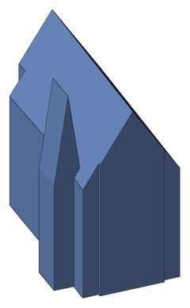<br><sub>38 × 28 × 37 mm</sub></td><td align="center" valign="middle">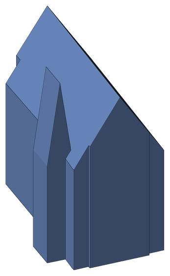<br><sub>55 × 41 × 55 mm</sub></td></tr>
<tr><td valign="middle"><b>02 Neues Augusteum</b><br><sub>am Augustusplatz</sub><br><sub>ca. 28 m hoch</sub></td><td align="center" valign="middle">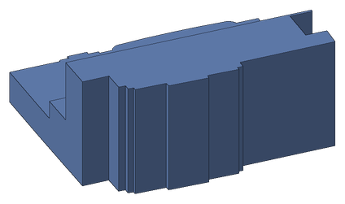<br><sub>40 × 47 × 19 mm</sub></td><td align="center" valign="middle">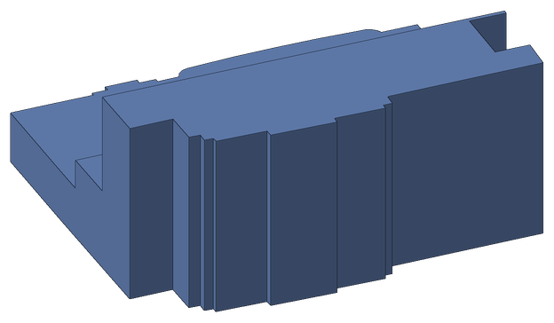<br><sub>60 × 70 × 28 mm</sub></td></tr>
<tr><td valign="middle"><b>03 Hörsaalgebäude</b><br><sub>mit Mensa am Park</sub><br><sub>ca. 14 m hoch</sub></td><td align="center" valign="middle">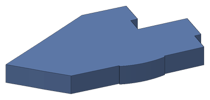<br><sub>55 × 90 × 9 mm</sub></td><td align="center" valign="middle">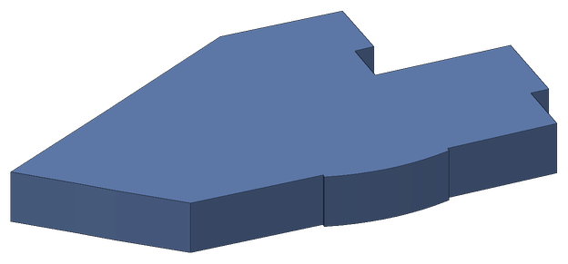<br><sub>82 × 136 × 14 mm</sub></td></tr>
<tr><td valign="middle"><b>04 Seminargebäude</b><br><sub>ca. 21 m hoch</sub></td><td align="center" valign="middle">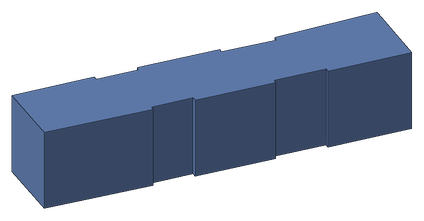<br><sub>25 × 65 × 14 mm</sub></td><td align="center" valign="middle">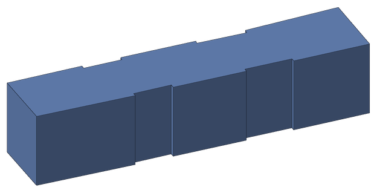<br><sub>38 × 98 × 21 mm</sub></td></tr>
<tr><td valign="middle"><b>05 Institutsgebäude</b><br><sub>Wirtschaftswiss. Fakultät, Grimmaische Str. 12</sub><br><sub>ca. 17,5 m hoch</sub></td><td align="center" valign="middle">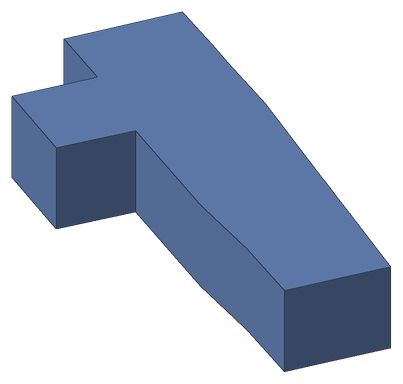<br><sub>70 × 32 × 12 mm</sub></td><td align="center" valign="middle">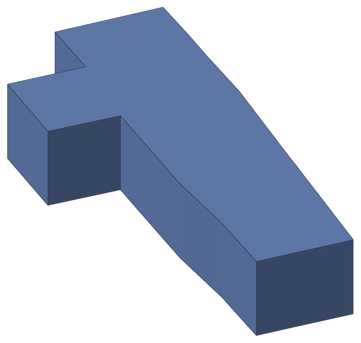<br><sub>105 × 48 × 18 mm</sub></td></tr>
<tr><td valign="middle"><b>06 City-Hochhaus</b> <sup>Extra</sup><br><sub>„Uniriese“</sub><br><sub>ca. 155 m hoch</sub></td><td align="center" valign="middle">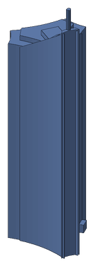<br><sub>33 × 30 × 103 mm</sub></td><td align="center" valign="middle">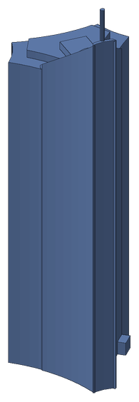<br><sub>48 × 45 × 155 mm</sub></td></tr>
<tr><td valign="middle"><b>07 Moritzbastei</b> <sup>Extra</sup><br><sub>historische Bastion</sub><br><sub>ca. 4 m hoch</sub></td><td align="center" valign="middle">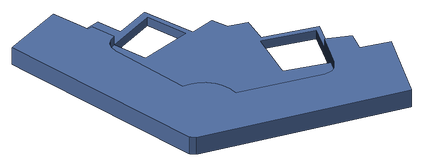<br><sub>45 × 43 × 3 mm</sub></td><td align="center" valign="middle">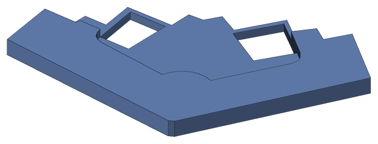<br><sub>67 × 65 × 4 mm</sub></td></tr>
</table>
<!-- /AUTO:gebaeude -->

Paulinum und Neues Augusteum bilden in echt einen zusammenhängenden Baukörper;
hier sind sie getrennt, passen aber Kante an Kante zusammen.

## Grundplatte zum Einsetzen

Die Grundplatte hat passgenaue Aussparungen (0,25 mm Spiel): Gebäude einzeln
drucken – oder in verschiedenen Farben –, einsetzen, fertig.

<!-- AUTO:grundplatte -->
<p align="center">
  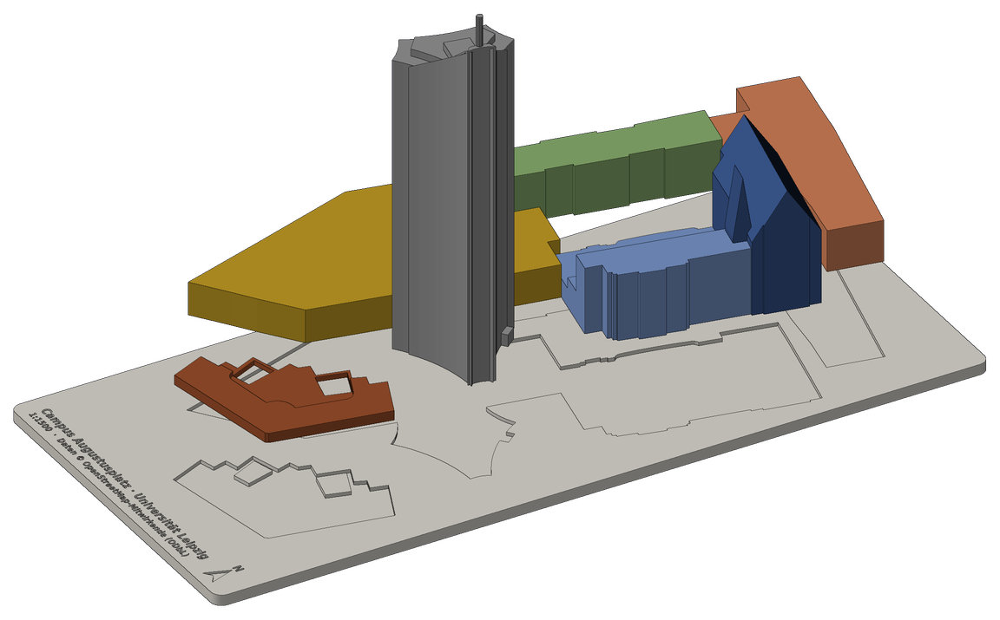
</p>
<!-- /AUTO:grundplatte -->

<details>
<summary><b>Alle Vorschaubilder</b> (Übersichten und jede einzelne Datei)</summary>

<br>

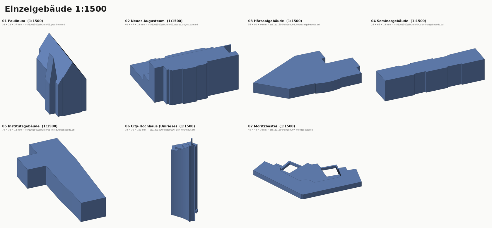


Vorschaubilder zu jeder einzelnen Datei – Gebäude, Komplettmodelle, Grundplatten –
liegen in [`vorschau/1zu1500/`](vorschau/1zu1500/) und [`vorschau/1zu1000/`](vorschau/1zu1000/).

</details>

## Dateien

Unter `stl/1zu1000/` und `stl/1zu1500/` liegen jeweils:

| Datei | Inhalt |
|-------|--------|
| `einzeln/NN_name.stl` | Jedes Gebäude einzeln, flache Unterseite, zentriert |
| `komplett_campus*.stl` | Alle Campusgebäude auf einer 2 mm Sockelplatte, in einem Stück |
| `komplett_campus_mit_extras*.stl` | Dasselbe mit Uniriese und Moritzbastei |
| `grundplatte_campus*.stl` | 3 mm Platte mit 1 mm tiefen Aussparungen (0,25 mm Spiel) für die Einzelgebäude |
| `komplett_*_objekte.3mf` | Sockelplatte und Gebäude als **getrennte Objekte** an der richtigen Position: im Slicer einzelne Teile weglassen oder verschiedenen Farben/Filamenten zuordnen |

Die Platten tragen eine eingravierte Beschriftung und einen Nordpfeil.

**1:1500** passt komplett auf übliche Druckbetten (Komplettmodell ca. 100 × 196 mm,
mit Extras 100 × 215 mm).
**1:1000** ist für die Platten zu groß für ein 250-mm-Bett und wurde deshalb
automatisch in `_teil1`/`_teil2` geteilt (stumpf aneinanderkleben). Die Einzelgebäude
passen auf jedes Bett.

## Druckhinweise

- Material: PLA, 0,4-mm-Düse, Schichthöhe 0,12–0,2 mm.
- Keine Stützstrukturen nötig: Überhänge (z. B. aufgeständerte Bauteile) sind
  zum Drucken nach unten aufgefüllt.
- Infill 10–15 %, 2–3 Wände genügen. Beim Uniriese (155 mm hoch bei 1:1000) ggf.
  Brim verwenden.
- Schrift auf den Platten: am besten mit 0,4-mm-Düse und feiner Schichthöhe;
  alternativ im Slicer „Ironing“ für die Oberseite.
- Ist die Passung in der Grundplatte zu stramm/locker, `POCKET_CLEARANCE` in
  `generate.py` anpassen und neu erzeugen.

## Genauigkeit

Die Modelle sind vereinfachte Klötzchenmodelle (LoD 1–2) aus OSM-Grundrissen,
Höhen und Dachformen – keine Fassadendetails. Wo OSM keine Höhe angibt, wird sie aus
der Geschosszahl geschätzt (3,5 m je Geschoss): Hörsaalgebäude 14 m,
Seminargebäude 21 m, Institutsgebäude 17,5 m. Paulinum (51 m, Turm 55 m) und
Neues Augusteum (28 / 12,6 / 8 m) nutzen die in OSM eingetragenen Höhen.

## Neu erzeugen / anpassen

```bash
pip install -r requirements.txt
python3 generate.py                # 1:1000 und 1:1500
python3 generate.py --scale 750    # anderer Maßstab (mehrfach angebbar)
python3 generate.py --fetch        # aktuelle OSM-Daten laden
python3 preview.py                 # nur Vorschau- und README-Bilder neu rendern
python3 readme.py                  # nur die automatischen Blöcke der README aktualisieren
python3 preview.py datei.stl --azim -90 --elev 40   # eigene Ansicht einer Datei
```

`generate.py` rendert am Ende automatisch alle Vorschaubilder nach `vorschau/`
(eigener Software-Renderer, keine Grafikkarte/Display nötig) und aktualisiert die
Galerie in dieser README (Bereiche zwischen `<!-- AUTO:… -->`-Markern; der übrige
Text darf von Hand bearbeitet werden).

Welche Gebäude enthalten sind, steht in der Liste `BUILDINGS` in `generate.py`
(per OSM-ID). Weitere Gebäude, z. B. Gewandhaus (`r152769`) oder Oper
(`w18920139`), lassen sich dort ergänzen, sofern sie im Datenausschnitt
(`OSM_BBOX`) liegen. Weitere Parameter (Wandstärke, Plattendicke, Bettgröße)
stehen oben im Skript.

## Lizenz der Daten

Geometrie und Höhen: © OpenStreetMap-Mitwirkende, verfügbar unter der
[Open Database License (ODbL)](https://www.openstreetmap.org/copyright).
Die erzeugten Modelle sind ein abgeleitetes Werk; bei Weitergabe bitte die
Quelle nennen.
