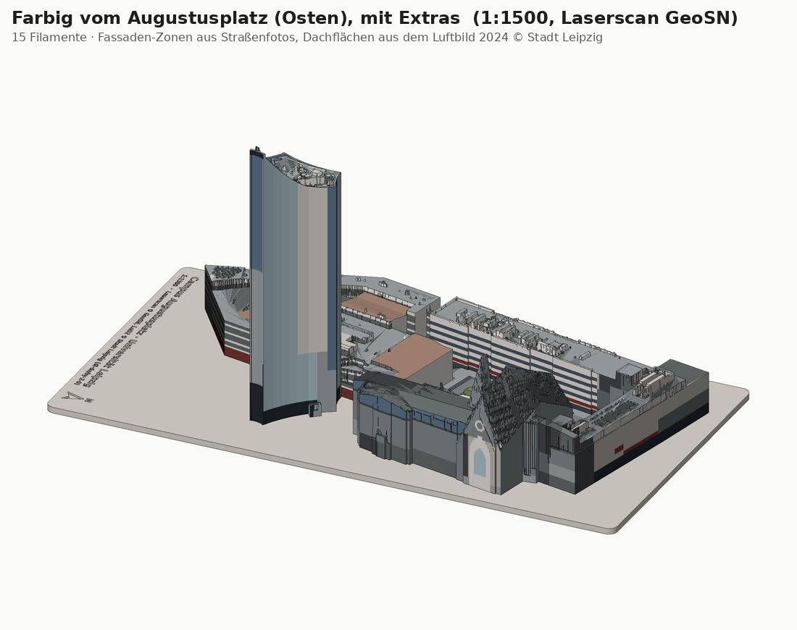
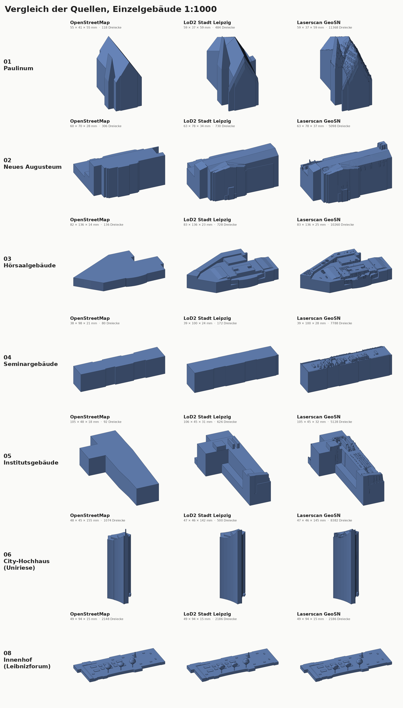
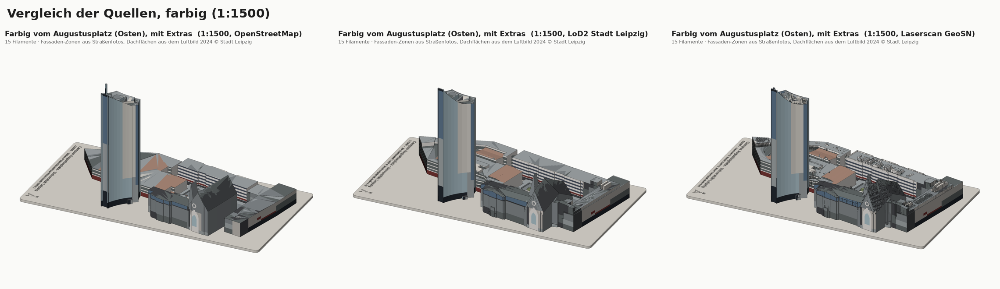
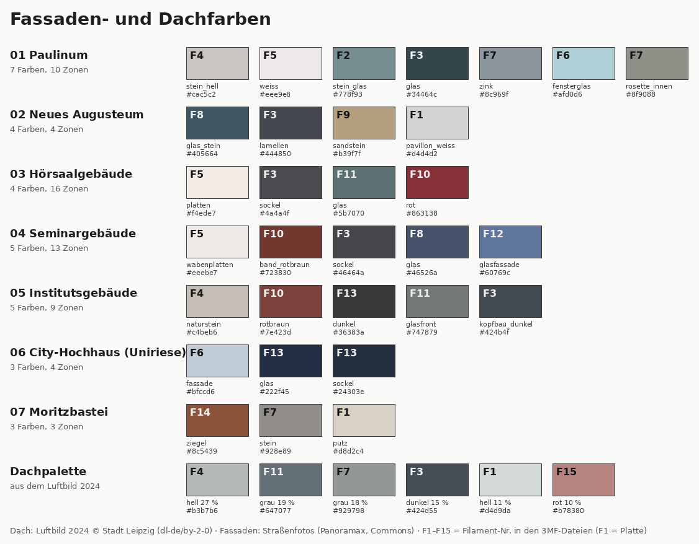
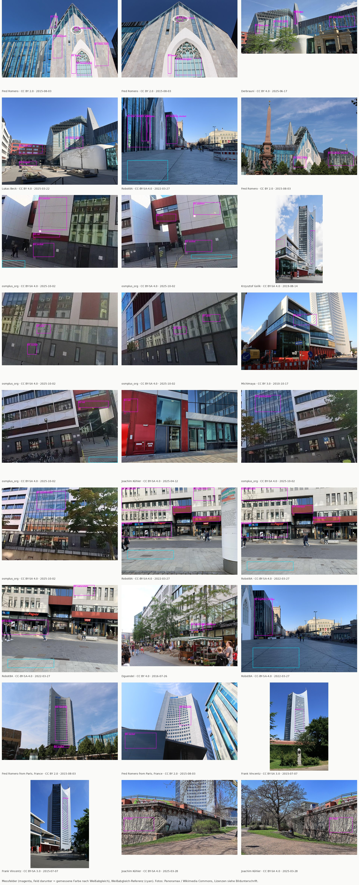
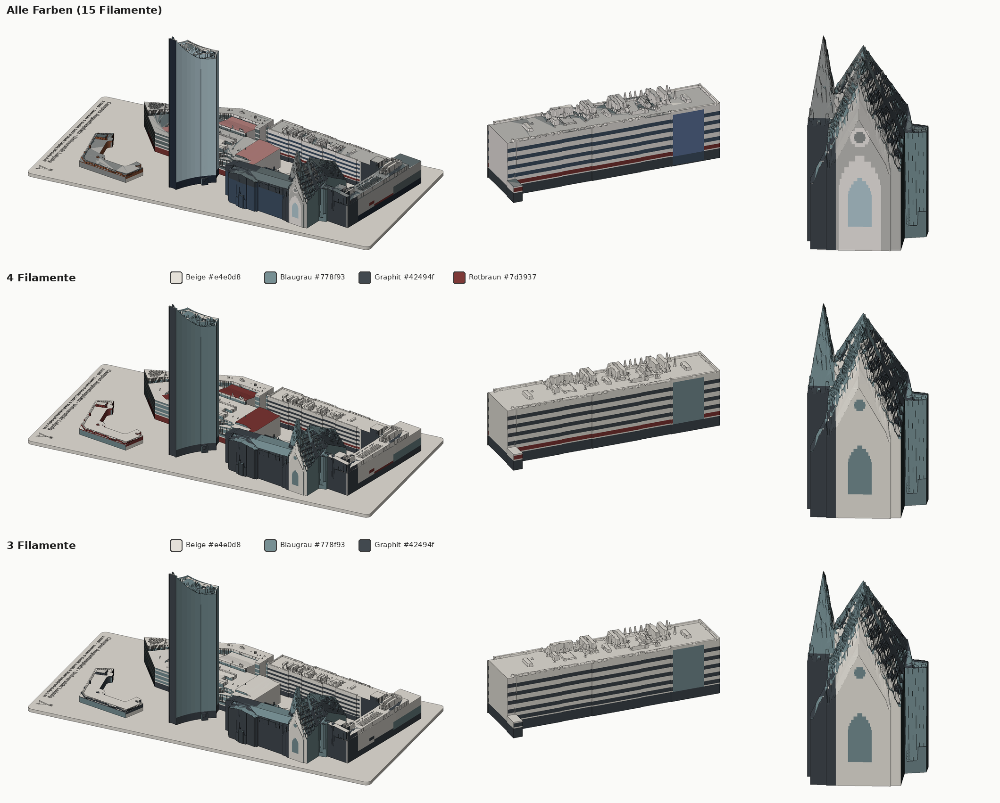

# Campus Augustusplatz – 3D-Druck

Druckdateien für das **Neue Augusteum**, das **Paulinum** und die übrigen Gebäude
des Campus Augustusplatz der Universität Leipzig. Jedes Gebäude lässt sich einzeln
drucken. Zusätzlich gibt es ein Komplettmodell und eine Grundplatte mit Aussparungen,
in die man die einzeln gedruckten Gebäude einsetzen kann.

Alle Modelle gibt es aus **drei Datenquellen nebeneinander**, damit man sie vergleichen
kann (Details siehe [Datenquellen](#datenquellen)):

| Quelle | Ordner | Detailgrad |
|--------|--------|------------|
| OpenStreetMap | `stl/osm/` | Klötzchen aus Grundriss + Höhe, Höhen teils nur geschätzt |
| 3D-Stadtmodell LoD2 der Stadt Leipzig | `stl/lod2/` | amtliche Höhen, Dachformen und größere Dachaufbauten |
| Laserscan GeoSN 2023 (+ LoD2) | `stl/laserscan/` | gemessene Dachlandschaft: Technikaufbauten, Oberlichter, Höfe, Turmkrone |







Vorschaubilder zu jeder einzelnen Datei liegen in [`vorschau/`](vorschau/)
(`vorschau/<quelle>/…`, Einzelvergleiche in `vorschau/vergleich/`).

## Gebäude

Maße bei 1:1000 (B × T × H in mm, 1 mm = 1 m):

| Nr. | Gebäude | OSM | LoD2 | Laserscan |
|----|---------|-----|------|-----------|
| 01 | Paulinum (Aula/Universitätskirche St. Pauli) | 55 × 41 × 55 | 59 × 37 × 59 | 59 × 37 × 59 |
| 02 | Neues Augusteum | 60 × 70 × 28 | 63 × 78 × 34 | 63 × 78 × 38 |
| 03 | Hörsaalgebäude (mit Mensa am Park) | 82 × 136 × 14 | 83 × 136 × 23 | 83 × 136 × 25 |
| 04 | Seminargebäude | 38 × 98 × 21 | 39 × 100 × 24 | 39 × 100 × 28 |
| 05 | Institutsgebäude / Wirtschaftswiss. Fakultät (Grimmaische Str. 12) | 105 × 48 × 18 | 106 × 45 × 31 | 105 × 45 × 32 |
| 06 | *Extra:* City-Hochhaus („Uniriese“) | 48 × 45 × 155 | 47 × 46 × 142 | 47 × 46 × 145 |
| 07 | *Extra:* Moritzbastei | 67 × 65 × 4 | 67 × 64 × 6 | 67 × 64 × 9 |

Auffällig: Für Hörsaal-, Seminar- und Institutsgebäude hat OSM keine Höhen, sie
werden dort aus der Geschosszahl geschätzt und sind deutlich zu niedrig (z. B.
Institutsgebäude 17,5 m statt 31 m). Der Uniriese ist in OSM mit Antenne (155 m)
eingetragen; LoD2/Laserscan enden an der Dachkrone (142–145 m).

Paulinum und Neues Augusteum bilden in echt einen zusammenhängenden Baukörper;
hier sind sie getrennt, passen aber Kante an Kante zusammen. Bei LoD2/Laserscan
verläuft die Trennung entlang der OSM-Grundrisse (siehe `lod2.py`).

## Dateien

Unter `stl/<quelle>/1zu1000/` und `stl/<quelle>/1zu1500/` liegen jeweils:

| Datei | Inhalt |
|-------|--------|
| `einzeln/NN_name.stl` | Jedes Gebäude einzeln, flache Unterseite, zentriert |
| `komplett_campus*.stl` | Alle Campusgebäude auf einer 2 mm Sockelplatte, in einem Stück |
| `komplett_campus_mit_extras*.stl` | Dasselbe mit Uniriese und Moritzbastei |
| `grundplatte_campus*.stl` | 3 mm Platte mit 1 mm tiefen Aussparungen (0,25 mm Spiel) für die Einzelgebäude |
| `komplett_*_objekte.3mf` | Sockelplatte und Gebäude als **getrennte Objekte** an der richtigen Position, **mehrfarbig vorbereitet**: jedes Gebäude hat sein Fassaden-Filament, die Dächer sind mit dem Dach-Filament vorbemalt (siehe [Mehrfarbig drucken](#mehrfarbig-drucken)) |
| `komplett_*_objekte_3filamente.3mf`, `…_4filamente.3mf` | dasselbe mit nur 3 bzw. 4 Filamenten (nur Laserscan mit Extras, siehe [Mit nur 3 oder 4 Filamenten](#mit-nur-3-oder-4-filamenten)) |

Die Platten tragen eine eingravierte Beschriftung (mit Quellenangabe) und einen Nordpfeil.

**1:1500** passt komplett auf übliche Druckbetten (Komplettmodell ca. 100 × 196 mm,
mit Extras 100 × 215 mm).
**1:1000** ist für die Platten zu groß für ein 250-mm-Bett und wurde deshalb
automatisch in `_teil1`/`_teil2` geteilt (stumpf aneinanderkleben). Die Einzelgebäude
passen auf jedes Bett.

## Datenquellen

### OpenStreetMap (`stl/osm/`)
Grundrisse, Höhen und Dachformen aus OSM (`data/augustusplatz.osm`), Klötzchenmodell
LoD 1–2. Wo OSM keine Höhe angibt, wird sie aus der Geschosszahl geschätzt
(3,5 m je Geschoss).

### 3D-Stadtmodell LoD2 der Stadt Leipzig (`stl/lod2/`)
[Open Data der Stadt Leipzig](https://opendata.leipzig.de/dataset/3d-stadtmodell-lod2-stadt-leipzig)
(CityGML, Stand 2023/24, ohne Texturen). Amtliche Gebäudehöhen und Dachformen aus
Kataster und Laserscan, inkl. größerer Dachaufbauten. Im Repo liegt nur der
Ausschnitt mit den Campus-Gebäuden (`data/lod2_campus.gml`). Der Gebäudekomplex
Paulinum/Augusteum/Hörsaalgebäude ist dort *ein* Gebäude mit 47 Bauteilen und wird
entlang der OSM-Grundrisse aufgeteilt; Volumen = Prismen unter allen Dachflächen.

### Laserscan GeoSN (`stl/laserscan/`)
[Laserscandaten des GeoSN](https://www.geodaten.sachsen.de/downloadbereich-digitale-hoehenmodelle-4851.html)
(Befliegung 9. 1. 2023, ca. 18 Punkte/m²). Ausschnitt in `data/laserscan_campus.laz`.
Je Gebäude wird ein Höhenraster (30 cm, an der Hauptachse des Gebäudes
ausgerichtet, damit Kanten nicht treppig werden) aus den Dachpunkten gebildet und
mit dem LoD2-Grundriss ausgeschnitten – dadurch senkrechte, glatte Außenwände. Wo
der Scan höchstens ±0,5 m vom LoD2-Dach abweicht, wird die glatte LoD2-Dachfläche
genommen (kein Messrauschen); schmale Vertiefungen unter dem LoD2-Dach (< 3 m,
meist Messlücken an Dachkanten oder über Glas) werden ebenfalls aus LoD2 gefüllt.
Alles andere (Aufbauten, Oberlichter, Lichthöfe, Dachterrassen, Turmkrone) kommt
aus dem Scan. Fassadendetails (Fenster, Gesimse) enthält auch der Laserscan
nicht – er sieht nur von oben.

### Weitere geprüfte Quellen
- **LoD2 des GeoSN** (landesweit, Stand 2024): gleiche Detailstufe wie das Leipziger
  Modell, deshalb nicht zusätzlich eingebaut.
- **DOM1** (Oberflächenmodell 1 m, GeoSN): gröber als die Punktwolke.
- **Texturiertes LoD2 / LoD3 der Stadt Leipzig**: existiert, ist aber nur im
  Web-Viewer zu sehen, nicht als Open Data herunterladbar.
- **Schrägluftbilder**: für Leipzig nicht offen verfügbar.
- **Google Earth / Maps 3D**: nur zur Sichtkontrolle genutzt. Die Nutzungsbedingungen
  erlauben kein Ableiten von Daten (Maße, Farben), und der Paulinum-Giebel ist dort
  eingerüstet.

## Farben

Die Modelle sind **abschnittsweise** eingefärbt: Jede Fassade ist in Zonen
gegliedert (Sockel, Bänder, Fensterbänder, Glasflächen, farbige Verkleidungen,
eigene Bauteile wie die Mensa am Park), und die Dächer zeigen die Farbflächen
aus dem Luftbild. Einzelne Steine oder Fenster einer Lochfassade werden nicht
abgebildet, deren Fläche erscheint im Gesamteindruck.


- **Fassaden** (`data/fassaden/<gebäude>.json`): benannte Farben, jede gemessen als
  Median über Bildausschnitte aus offen lizenzierten **Straßenfotos**
  (Fotokatalog `data/fotos.json`: Panoramax, Wikimedia Commons inkl. einer
  360°-Fahrt durch die Universitätsstraße, die `farben.py` selbst in normale
  Ansichten umrechnet), mit Weißabgleich am grauen Pflaster in derselben
  Beleuchtung. Dazu die **Zonen**: Höhe über Gelände, Fassadenseite
  (Himmelsrichtung) und Abschnitt entlang der Fassade; außerdem runde Flächen
  (`kreis`, z. B. die Rosette am Paulinum) und Spitzbögen (`bogen`, z. B. Blende
  und Maßwerkfenster des Paulinum-Giebels), die als feine Treppe angenähert
  werden. Lage und Größe solcher Elemente lassen sich aus einem Foto mit einem
  Kameramodell bestimmen (Giebelkontur aus LoD2 + Foto,
  `werkzeuge/rosette_kamera.py`). Wo die Fotos eine Fläche nur im Schatten oder
  mit Spiegelungen zeigen, steht statt der Messung eine feste Farbe (`hex`) mit
  Begründung (`quelle`). Format und
  Prüfwerkzeug siehe `fassaden.py`; Prüfansichten je Gebäude in
  `vorschau/fassaden/`.
- **Dächer**: [Luftbild 2024 der Stadt Leipzig](https://opendata.leipzig.de/dataset/luftbild-2024-20-cm-bodenauflosung-stadt-leipzig)
  (20 cm, dl-de/by-2-0). Daraus werden wenige typische Dachfarben bestimmt
  (Dachpalette, k-means); jede Dachfläche bekommt die Klasse, die das Luftbild an
  ihr zeigt (rote Dächer, helle und dunkle Flachdächer, Glas).
- `python3 farben.py` misst alles neu und schreibt `data/farben.json`;
  `generate.py` macht das automatisch, wenn sich Fassaden- oder Fotodaten geändert
  haben.





Die Farben sind Anhaltswerte (Fotos im Schatten, Glas spiegelt); die Lage der
Zonen ist aus Fotos und Geschosszahlen abgeleitet (Genauigkeit etwa ±0,5–1 m,
Hofseiten ohne Foto plausibel ergänzt – Details in den Notizen der Zonendateien).

## Mehrfarbig drucken

Die `*_objekte.3mf` sind fertig vorbemalt, in den Formaten, die die Slicer selbst
lesen (geprüft am Quellcode von PrusaSlicer 2.7–2.9, Bambu Studio und OrcaSlicer):

- Jedes Gebäude ist an seinen Zonengrenzen zerschnitten (Netz bleibt dicht).
- **Objekt-Filament** = häufigste Wandfarbe des Gebäudes
  (`Metadata/model_settings.config` für Bambu/Orca, `Metadata/Slic3r_PE_model.config`
  für PrusaSlicer).
- **Alle anderen Flächen vorbemalt** (`paint_color` bzw.
  `slic3rpe:mmu_segmentation`) – im Slicer als Mehrfarben-Bemalung sichtbar und
  nachbearbeitbar.
- Zusätzlich `basematerials` (3MF-Standard) für Betrachter wie den
  Windows-3D-Viewer; Slicer ignorieren diese.

Die Filament-Nummern sind für alle Dateien gleich; welche Farbe zu welcher Nummer
gehört, zeigt `vorschau/farben.png` (Feld „F…“, Liste in `data/farben.json` →
`_filamente`). Ähnliche Töne werden automatisch zusammengelegt, höchstens 15
Filamente (Grenze PrusaSlicer; `FILAMENT_TOLERANZ`, `MAX_FILAMENTE` in
`farben.py`). Die farbigen Vorschaubilder zeigen genau diese Filamentfarben, also
das, was gedruckt wird. Die Filamentfarben selbst kann eine 3MF-Datei ohne
vollständiges Druckerprofil nicht mitbringen: Bambu Studio/OrcaSlicer legen beim
Öffnen automatisch genügend Filamente an (Farben anpassen bzw. gleiche Farben
zusammenlegen), in PrusaSlicer braucht es ein Mehrfarb-Druckerprofil (MMU/XL).
Wer weniger Filamente hat, ordnet einfach mehreren Nummern dasselbe Filament zu.
Cura liest keine Farben aus 3MF.

### Mit nur 3 oder 4 Filamenten

Wer keine 15 Filamente hat (ein AMS fasst 4), nimmt die reduzierten Dateien
`komplett_campus_mit_extras_objekte_3filamente.3mf` bzw. `…_4filamente.3mf`
(Laserscan, beide Maßstäbe). Es sind dieselben Objekte, nur mit weniger Farben; die
Filament-Nummern sind hier 1–3 bzw. 1–4.



| Nr. | Filament | Wo |
|----|----------|----|
| 1 | Beige `#e4e0d8` | Stein, helle Platten, Sockelplatte |
| 2 | Blaugrau `#778f93` | Glas und Fenster (Maßwerkfenster und Rosette am Paulinum), Glasfassade des Uniriese, Dächer von Paulinum, Neuem Augusteum und Uniriese |
| 3 | Graphit `#42494f` | Sockel, dunkle Bänder und Fensterbänder, dunkles Glas |
| 4 | Rotbraun `#7d3937` (nur 4 Filamente) | Brüstungsbänder, rote Wandflächen und Dächer, Ziegel der Moritzbastei |

Die Palette ist so gewählt, dass die **Kontraste an den Kanten zwischen Zonen** erhalten
bleiben, also die hellen und dunklen Bänder (z. B. am Seminargebäude) und die Fenster,
und nicht so, dass jeder Farbton stimmt. Dafür gelten drei Regeln (`PROFILE` und
`PROFIL_*` in `farben.py`):

- Jede Farbe wird der nächsten Profilfarbe zugeordnet (CIE-Lab).
- Fenster und Glas sind immer Blaugrau. Nach dem Nächste-Farbe-Prinzip würden sie sonst
  zu Beige und verschwinden im Giebel.
- Die Dächer von Hörsaal-, Seminar- und Institutsgebäude und der Moritzbastei sind nie
  Blaugrau: Das Blaugrau im Luftbild ist dort vor allem Schatten, die Dächer werden
  Beige. Rote Dächer bleiben bei 4 Filamenten rotbraun.

Was verloren geht: die weiße Blende um das Maßwerkfenster (Weiß und Beige sind eine
Farbe), und bei 3 Filamenten verschmilzt das rotbraune Band mit dem Graphit des Sockels.
Das Band ist bei 1:1500 nur etwa 0,5 mm hoch, für Bänder und Fenster lohnt eher 1:1000.
Grob geschätzt (aus den bemalten Außenflächen, 0,2-mm-Lagen, 1:1500) sinkt die Zahl der
Farbwechsel von etwa 2300 auf etwa 740 (3 Filamente) bzw. 820 (4 Filamente). Das bleibt
viel Spülabfall und Druckzeit.

Weitere Quellen und Varianten gibt es auf Anfrage mit
`python3 generate.py --filamente 3 --filamente 4` (für alle gewählten Quellen und
Varianten, jede Datei ca. 2–6 MB).

## Druckhinweise

- Material: PLA, 0,4-mm-Düse, Schichthöhe 0,12–0,2 mm.
- Keine Stützstrukturen nötig: Überhänge (z. B. aufgeständerte Bauteile) sind
  zum Drucken nach unten aufgefüllt.
- Infill 10–15 %, 2–3 Wände genügen. Beim Uniriese (ca. 145 mm hoch bei 1:1000) ggf.
  Brim verwenden.
- Laserscan-Modelle: viele kleine Dachdetails (0,3 mm Raster) – feine Schichthöhe
  (0,12 mm) lohnt sich.
- Schrift auf den Platten: am besten mit 0,4-mm-Düse und feiner Schichthöhe;
  alternativ im Slicer „Ironing“ für die Oberseite.
- Ist die Passung in der Grundplatte zu stramm/locker, `POCKET_CLEARANCE` in
  `generate.py` anpassen und neu erzeugen.

## Neu erzeugen / anpassen

```bash
pip install -r requirements.txt
python3 generate.py                     # alle Quellen, 1:1000 und 1:1500
python3 generate.py --quelle laserscan  # nur eine Quelle (mehrfach angebbar)
python3 generate.py --filamente 3       # zusätzlich 3MF mit nur 3 (oder 4) Filamenten
python3 generate.py --scale 750         # anderer Maßstab (mehrfach angebbar)
python3 generate.py --fetch             # Quelldaten neu laden (LoD2 130 MB, Laserscan 240 MB)
python3 farben.py                       # Farben neu messen (data/farben.json)
python3 fassaden.py 03_hoersaalgebaeude # Prüfansicht der Fassaden-Zonen eines Gebäudes
python3 preview.py                      # nur Vorschaubilder neu rendern
python3 preview.py datei.stl --azim -90 --elev 40   # eigene Ansicht einer Datei
```

`generate.py` rendert am Ende automatisch alle Vorschaubilder nach `vorschau/`
(eigener Software-Renderer, keine Grafikkarte/kein Display nötig).

Welche Gebäude enthalten sind, steht in der Liste `BUILDINGS` in `generate.py`
(per OSM-ID). Weitere Gebäude, z. B. Gewandhaus (`r152769`) oder Oper
(`w18920139`), lassen sich dort ergänzen, sofern sie im Datenausschnitt
(`OSM_BBOX`) liegen; für LoD2/Laserscan danach `--fetch` ausführen, damit die
Ausschnitte in `data/` neu geschnitten werden. Weitere Parameter (Wandstärke,
Plattendicke, Bettgröße) stehen oben in `generate.py`, die Laserscan-Parameter
(Raster, Einrast-Toleranz) oben in `laserscan.py`.

## Lizenzen der Daten

- Geometrie und Höhen OSM: © OpenStreetMap-Mitwirkende,
  [ODbL](https://www.openstreetmap.org/copyright).
- 3D-Stadtmodell LoD2 und Luftbild 2024: © Stadt Leipzig, Amt für Geoinformation und
  Bodenordnung, [dl-de/by-2-0](https://www.govdata.de/dl-de/by-2-0).
- Laserscandaten: © Landesamt für Geobasisinformation Sachsen (GeoSN),
  [dl-de/by-2-0](https://www.govdata.de/dl-de/by-2-0).
- Straßenfotos für die Fassadenfarben: Panoramax und Wikimedia Commons, Urheber,
  Lizenz (CC0, CC BY, CC BY-SA) und Link je Foto in [`FOTOQUELLEN.md`](FOTOQUELLEN.md).
  Die Vorschaubilder mit Fotoausschnitten (`vorschau/farben_fotoproben.jpg`,
  `vorschau/fassaden/*_fotos.jpg`) stehen unter der Lizenz des jeweiligen Fotos.

Die erzeugten Modelle sind abgeleitete Werke; bei Weitergabe bitte die Quellen nennen.
