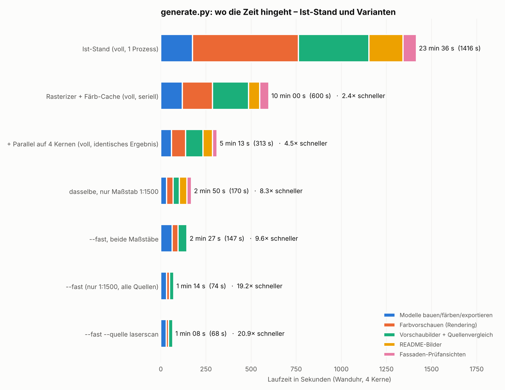

# Laufzeit von `generate.py`

Messung vom 13.10.2026 auf 4 Kernen. Ist-Stand = Stand vor der Optimierung
(`phasen_ist_stand.py` misst ihn über Funktions-Wrapper; Zahlen in `messwerte.json`).

## Wo die Zeit hinging (Ist-Stand, 1416 s)

| Phase | Zeit | Anteil |
|---|---|---|
| Farbvorschauen (Software-Renderer, 12 Aufrufe à 2 Ansichten + Kacheln) | 587 s | 41 % |
| Vorschaubilder je Quelle + Quellenvergleich | 390 s | 28 % |
| Modelle bauen, färben, exportieren | 175 s | 12 % |
| README-Bilder | 189 s | 13 % |
| Fassaden-Prüfansichten | 74 s | 5 % |

Die **Geometrie** (OSM, LoD2, Laserscan zusammen) braucht nur ~17 s. Die Laserdaten bremsen
indirekt: Das Laser-Modell hat ~500 000 Dreiecke, und der Renderer rasterte jedes einzeln in
einer Python-Schleife (~85 µs je Dreieck). 82 % der Laufzeit sind Rendering.

## Maßnahmen

| Maßnahme | Wirkung | Ergebnis |
|---|---|---|
| `preview.rasterize`: kleine Dreiecke gestapelt vektorisiert statt einzeln | Rendern 3–12× schneller | pixelgleich (getestet gegen alte Funktion) |
| `colourise`-Cache: `campus` ist Teilmenge von `campus_mit_extras` | Färben halbiert | gleiche Geometrie (Fläche/Volumen, dicht); einzelne Mikrodreiecke können durch Rundung abweichen |
| `fassaden.colour_mesh`: Dichtheitsprüfung nur am Ende statt nach jedem Schnitt | Färben −30 % | bitidentisch, Rückfall auf die alte Schleife, falls nicht dicht |
| `parallel.py`: Builds, Render-Jobs, Vorschauen, README-Bilder, Fassadenansichten auf alle Kerne | ~2× auf 4 Kernen | identisch |
| `--fast` | siehe unten | gleiche Daten, gröber |

## Vergleich

| Variante | Zeit | Faktor |
|---|---|---|
| Ist-Stand | 1416 s (23:36) | 1× |
| Rasterizer + Färb-Cache, seriell | 600 s | 2,4× |
| + Parallel (Standardlauf heute) | 313 s | 4,5× |
| Standardlauf nur `--scale 1500` | 170 s | 8,3× |
| `--fast`, beide Maßstäbe | 147 s | 9,6× |
| `--fast` (nur 1:1500) | 74 s | 19× |
| `--fast --quelle laserscan` | 68 s | 21× |
| `--fast --jobs 1` (seriell) | 125 s | 11× |

`--fast`: Laser-Raster 0,6 statt 0,3 m (¼ der Dreiecke), Vorschau ohne Kantenglättung,
nur Maßstab 1:1500, keine README-/Fassaden-/Vergleichsbilder; schreibt nach `stl-fast/` und
`vorschau-fast/`. Die Zeiten schwanken durch Last auf der Maschine um etwa ±10 %.

## Hohlkörper (`einzeln_hohl/`, 2026-10-17)

Mit den Hohlkörpern (`hohl.py`) kam je Quelle und Maßstab ein Schritt dazu. Gemessen seriell (`build_scale`, Laserscan 1:1000, Zeitnahme je Funktion;
cProfile schrieb einen Teil fälschlich dem Textsatz von matplotlib zu, die Gravur kostet nur 0,4 s):

| Maßnahme | vorher | nachher | Ergebnis |
|---|---|---|---|
| Farbige Schale: massiven Körper an den Zonen zerschneiden und färben, Hohlraum mit Manifold abziehen, Farbe je Dreieck als `face_id` mitnehmen (statt die fertige Schale zu zerschneiden) | 42 s je großem Gebäude, bis 433 000 Dreiecke, Speichermangel im Parallel-Lauf | 2 s, 130 000 Dreiecke | dicht, gleiche Zonenfarben |
| Gemeinsamer Farb-Cache: der für die Schale zerschnittene massive Körper wird für die Komplettmodelle wiederverwendet | colourise 11 s | 0 s | Fläche je Farbe bis 0,002 mm² gleich (Rundung), Bilder bis 0,005 % Pixel anders |
| `hohl._cs_poly`: Schnitt je zusammenhängendem Teil (`decompose`) statt symmetrischer Differenz aller ~120 Ringe | 11,7 s (Hörsaalgebäude) | 1,9 s | gleiche Fläche |
| Gewölbe: Distanztransformationen nur im wirksamen Ausschnitt | `ceiling` 6,0 s (Hörsaalgebäude 1:1000) | 2,3 s | gleich bis zur höchsten Ziel-Decke (Abweichung ≤ 6·10⁻⁶ mm) |
| Lagenschnitte des Hohlraums nur bei Bedarf (`hohl(..., lagen=False)` im Generator) | 4,8 s | 0 s | gleich |
| `export_3mf`: Ecken und Dreiecke in wenigen großen %-Operationen | 3,0 s (560 000 Dreiecke) | 1,9 s | Inhalt byte-gleich |
| `parallel.py`: `ProcessPoolExecutor` statt `Pool` | Lauf hing ewig, wenn ein Prozess durch Speichermangel starb | bricht mit `BrokenProcessPool` ab | – |

Laserscan 1:1000 seriell: 88 s → 60 s (ohne Gewölbe-Ausschnitt und Lagen-Verzicht gemessen); 1:1500: 34 s. Voller Lauf mit Hohlkörpern
(`python3 generate.py`, 4 Kerne): **273 s** (Modelle 79 s, Farbvorschauen 87 s, Vorschauen je Quelle 53 s, README 32 s, Fassaden 18 s), also
schneller als der Stand ohne Hohlkörper (313 s). Die Kompressionsstufe der 3MF bleibt 6: Stufe 1 spart 0,6 s je großer Datei, macht sie aber 30 % größer.

Ideen, noch nicht umgesetzt: Hohlkörper zwischen Läufen zwischenspeichern (Schlüssel: Netz des massiven Körpers, Parameter, Quelltext von `hohl.py`);
die Farbvorschauen (größter Posten) teilen sich die Kerne mit den Builds erst nach deren Ende.

## Numba-Rasterizer (2026-10-19)

Gemessen auf 4 Kernen, voller Lauf bis vor die Fassaden-Prüfansichten (deren Foto-Download scheitert in der Cloud-Sandbox mit HTTP 429):

| Schritt | vorher | nachher |
|---|---|---|
| Farbvorschauen (`run_render_jobs`) | 136 s | 35 s |
| Vorschauen je Quelle | 90 s | 47 s |
| README-Bilder | 32 s | 16 s |
| Lauf gesamt (ohne Fassaden) | 450 s | 197 s |

Maßnahme: `preview._raster_nb_py` (Z-Buffer-Schleife) und `preview._finish_nb_py` (Schattierung und Kantenlinien) laufen mit Numba statt in NumPy-Stapeln
und `float64`-Bildern. Einzelbild Laserscan-Teil (29 000 Dreiecke, 1400 × 1000, ss 2): 6,5 s → 0,3 s; kleines Gebäude 3,6 s → 0,2 s.
**Pixelgleich** zum NumPy-Pfad (0 abweichende Pixel; geprüft für ss 1 und 2, `flat` mit Farben je Dreieck, transparent, `px_per_mm`, Laserscan und
Einzelgebäude). Gleiche Formeln und gleiche Rangfolge bei Gleichstand. Ohne Numba oder mit `NO_NUMBA=1` läuft der alte Pfad unverändert.
`preview.warmup()` (aus `generate.main`) kompiliert vor dem Forken; der Cache liegt in `__pycache__`.

Offen: Die Geometrie-Phase „Modelle bauen“ (~100 s) ist jetzt der größte Posten; Idee: Hohlkörper zwischenspeichern (siehe oben).
